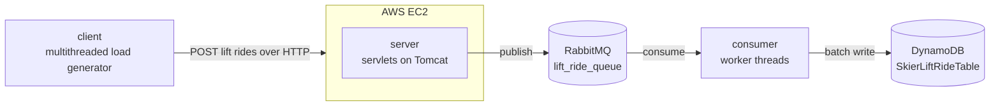

# Architecture

## Request flow

1. **Client.** `SkierClientMain` generates 200,000 random lift-ride events. It sends them from a warm-up phase of 32 threads and a main phase of 500 threads, and records the latency of every request.
2. **Server.** `SkierServlet` validates the URL and body, then publishes the event to RabbitMQ using a pool of 500 pre-created channels. It returns `201` once the event is queued, without waiting for processing.
3. **Queue.** RabbitMQ decouples ingestion from processing, so the API can keep accepting events when the consumer falls behind.
4. **Consumer.** `Consumer` runs 200 threads that move messages into a shared buffer. A flusher thread drains the buffer once a second and writes it to DynamoDB in batches of 25.

## Known limitations

- The consumer acknowledges a message when it enters the in-memory buffer, before the DynamoDB write. A crash or failed write can lose those events.
- Unprocessed DynamoDB batch items are logged, not retried.
- The server validates the season as `2025` and the day as `1`, which matches what the load generator sends.
